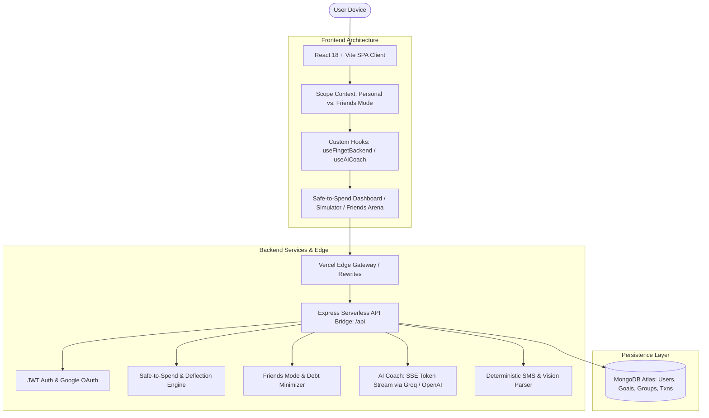

# 💸 FINGET
### The Decision-First Financial Cockpit & AI Money Coach
*Re-engineering personal & collaborative wealth from passive historical tracking to real-time affordability.*

---

<div align="center">

[](https://finget-ten.vercel.app/)
[](https://linkedin.com/in/dhairya-dani07)

[](https://react.dev/)
[](https://vitejs.dev/)
[](https://tailwindcss.com/)
[](https://nodejs.org/)
[](https://www.mongodb.com/)
[](#)
[](#)
[](https://opensource.org/licenses/MIT)

<br/>

> 🚀 **Official Live Production URL:** **[https://finget-ten.vercel.app/](https://finget-ten.vercel.app/)**  
> *A full-stack, AI-native personal and social finance ecosystem hosted on Vercel with real-time Safe Daily Allowance math, SSE streaming AI Money Coach, and privacy-preserving multi-user Friends Mode.*

<br/>

[ **⚡ Launch Finget App** ](https://finget-ten.vercel.app/) &nbsp;•&nbsp; [ **💡 The Paradigm Shift** ](#-the-decision-first-philosophy) &nbsp;•&nbsp; [ **✨ Core Innovations** ](#-core-innovations) &nbsp;•&nbsp; [ **🏗️ System Architecture** ](#-system-architecture) &nbsp;•&nbsp; [ **🚀 Local Setup** ](#-local-development)

</div>

---

## 💡 The Decision-First Philosophy

Traditional personal finance apps fail because they are **retrospective**—they present post-mortems of what you already spent when it is too late to change anything. 

**Finget** is built around an active decision engine: answering the exact question you have at the cash counter or checkout cart: **"Can I safely afford this right now without hurting my savings goals?"**

```
┌─────────────────────────────────────────────────────────────────────────────────┐
│                           TRADITIONAL APPS vs. FINGET                           │
├─────────────────────────┬───────────────────────────────────────────────────────┤
│ Traditional Spreadsheets│ "You spent ₹48,000 last month (₹12,000 on dining out)"│
│ ➔ Passive & Depressing  │ ✗ No guidance on what you can spend today             │
├─────────────────────────┼───────────────────────────────────────────────────────┤
│ FINGET Decision Engine  │ "Safe to spend TODAY: ₹1,450"                         │
│ ➔ Active & Liberating   │ ✓ Dynamic daily burn rate that guards your Goa goal   │
└─────────────────────────┴───────────────────────────────────────────────────────┘
```

| Dimension | Legacy Expense Trackers | Finget |
| :--- | :--- | :--- |
| **Core Question** | *"Where did my money go last month?"* | **"Can I afford this right now, today?"** |
| **Primary Metric** | Cumulative month-to-date spend | **Dynamic Safe Daily Allowance** |
| **Multiplayer / Splits** | Clunky manual spreadsheets or isolated apps | **Shared Friends Mode** with income-weighted splits & zero salary leakage |
| **AI Experience** | Generic weekly tips | **Context-Aware Streaming Coach (SSE)** with persistent memory |
| **Impulse Control** | Guilt after the transaction | **48-Hour Vault** to deflect impulsive purchases before they happen |
| **Data Ingestion** | Tedious manual entry | **Deterministic SMS parsing** + pluggable receipt vision |

---

## ✨ Core Innovations

### 1. 🛡️ Dynamic "Safe-to-Spend" Engine
Rather than relying on arbitrary static budgets, Finget calculates a live **Safe Daily Allowance**:

$$\text{Safe Daily Allowance} = \frac{\text{Monthly Income} - \text{Mandatory Obligations} - \text{Ring-Fenced Savings} - \text{Current Spend}}{\text{Days Remaining in Month}}$$

* **Instant Risk Telemetry:** Automatically categorizes your financial position into **Comfortable** (green), **Caution** (amber, approaching emergency buffer), or **Risky** (red, negative trajectory).
* **Paise-Level Precision:** All financial math uses integer paise internally to eliminate floating-point rounding errors across split calculations.

---

### 2. 🤖 Context-Aware AI Money Coach (SSE Streaming)
A specialized financial copilot that streams token-by-token using Server-Sent Events (SSE) for a responsive, ChatGPT-like conversation:
* **Deep Dynamic Context:** Injects your real-time income, daily safe allowance, top savings goals, and recent transaction anomalies directly into model prompts.
* **Persistent Session Memory:** Contextual memory layer (`AIConversation` schema) remembers your prior goals and trade-offs across sessions.
* **Degrades Gracefully:** Seamlessly falls back to deterministic rule-based advice when external LLM keys are unconfigured.

---

### 3. 👥 "Friends Mode" Collaborative Context Engine
Finance is inherently social. Finget introduces an **Explicit Scope Architecture** that toggles the entire dashboard between personal finances and shared group wallets:
* **Global Scope Toggle:** The frontend and backend explicitly branch operations based on `?context=user` or `?context=group&groupId=...`.
* **Income-Weighted Splits (Zero Salary Leakage):** Split group expenses proportionally according to ability to pay, without revealing any member's exact salary to the group.
* **Greedy Debt Minimizer:** Simplifies group balances to the absolute minimum number of settlement transfers.
* **Rotatable Invite Codes:** 6-character cryptographic tokens eliminate the need to share raw database IDs.

---

### 4. 🔮 Interactive Future Impact Simulator & "Goal Currency"
A slider-based "What-If" simulator that instantly tests prospective purchases:
* Translates any price tag into **Goal Currency** (e.g. *"Buying this ₹8,500 gadget delays your Japan Trip goal by 14 days"*).
* Simulates immediate impact on remaining monthly headroom and daily allowance before you swipe your card.

---

### 5. ⏳ The 48-Hour Deflection Vault
Confronts impulse shopping with behavioral psychology:
* Ring-fences prospective splurge amounts out of your safe-to-spend allowance for 48 hours.
* After 48 hours, Finget prompts you: *Buy it, or walk away?*
* Walking away credits the amount to your **Deflection Ledger**, celebrating money saved rather than shaming impulsive urges.

---

### 6. ⚡ Multi-Source Ingestion & PWA Ambient Number
* **Offline Bank SMS Parser:** Regex-powered client/server parsing extracts amounts, merchants, and dates locally from SMS text—sensitive financial text never leaves your device.
* **Pluggable Receipt Vision:** Screenshot import powered by vision models with automatic duplicate detection.
* **PWA & Offline Shell:** Installable to mobile home screens with offline caching of today's safe allowance.

---

## 🏗️ System Architecture



---

## 🔌 Core API Architecture

| Route | Method | Purpose |
| :--- | :--- | :--- |
| `/api/finance/affordability` | `GET` | Computes dynamic safe-to-spend figure and risk status for active scope. |
| `/api/ai/coach` | `POST` | Streams chunk-by-chunk contextual AI advice over Server-Sent Events (SSE). |
| `/api/groups` | `GET / POST` | List or create collaborative Friends Mode shared wallets. |
| `/api/groups/:id/balances` | `GET` | Computes minimal transfer settlement graph using greedy debt matching. |
| `/api/finance/future-impact` | `POST` | Calculates goal delay and daily allowance depletion for simulated purchases. |
| `/api/deflections` | `POST / GET` | Ring-fences prospective impulse purchases in the 48-hour vault. |
| `/api/receipts/parse-sms` | `POST` | Deterministic local bank SMS parsing without external data exposure. |
| `/api/finance/ambient` | `GET` | Lightweight (175 bytes) payload for mobile home-screen widgets and PWA. |

---

## 🚀 Local Development

### Prerequisites
* **Node.js:** `v18.0.0` or higher
* **npm:** `v9.0.0` or higher
* **MongoDB:** Local MongoDB instance or free MongoDB Atlas URI *(automatic in-memory fallback included)*

### Quick Start

```bash
# 1. Open project directory
cd Finget

# 2. Install dependencies (root + backend)
npm install
cd finget-backend && npm install && cd ..

# 3. Configure environment variables
# In finget-backend/.env:
# PORT=5001
# MONGO_URI=your_mongodb_atlas_uri
# JWT_SECRET=your_jwt_secret_key
# GROQ_API_KEY=your_groq_api_key (optional, for streaming AI Coach)

# 4. Start development servers
npm run dev
```

Visit `http://localhost:5173/` in your browser.

---

## 🌐 Production Deployment

Finget is configured for zero-configuration full-stack deployment on **Vercel**:

* **Live Web App:** **[https://finget-ten.vercel.app/](https://finget-ten.vercel.app/)**
* **Unified Build:** The frontend bundle (`dist/`) and serverless backend API (`api/index.js`) deploy seamlessly in a single pipeline via `vercel.json`.

---

## 👨‍💻 Author & Maintainer

* **Architect & Developer:** **Dhairya Dani**
* **LinkedIn:** [linkedin.com/in/dhairya-dani07](https://linkedin.com/in/dhairya-dani07)

---

## 🛡️ License

This project is licensed under the **MIT License** — see the [LICENSE](LICENSE) file for details.

*Built with precision to make financial freedom proactive, transparent, and social.*
